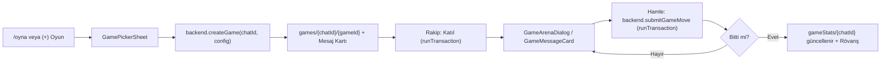

# Nuvelo Sohbet İçi Oyun Sistemi (`/oyna`) — Kusursuz Mimari & Uygulama Planı

> **Amaç:** Nuvelo sohbetlerinde (1-1 ve grup) `/oyna` komutuyla veya ataç (`+`) menüsünden arkadaşlarla anında kelime, masa ve müzik oyunları oynayabilmek. Bu belge, uygulayacak ajanın (Claude / Antigravity) tahmin yürütmeden, derleme veya veritabanı hatasına düşmeden doğrudan kodlayabileceği kesin teknik sözleşmedir.

---

## 1. Nuvelo Kod Tabanına Özel Kesin Teknik Kurallar

Bu kurallar doğrudan mevcut kod tabanı incelenerek çıkarılmıştır; ihlal edilirse derleme, Web sürümü veya üretim kuralları bozulur:

1. **Tek Renkli (Monochrome) Tasarım Sistemi (`QMusicTheme.kt`):**
   - Siyah ve beyaz dışında renkli vurgu **YOK**. Tüm oyun ekranları, tahtalar, klavyeler ve kartlar yalnızca `QMusicTheme.kt` adlandırılmış değerlerini (`BgRoot`, `DarkSurface`, `DarkSurfaceVariant`, `Ink`, `InkInverse`, `TextPrimary`, `TextSecondary`, `TextMuted`, `BorderSubtle`, `BorderHover`) kullanır; böylece Koyu / Açık / Saf Siyah (OLED) tema geçişlerinde otomatik uyum sağlar.
2. **`web/` Otomatik Kaynak Senkronizasyonu (`web/build.gradle.kts`):**
   - `web/build.gradle.kts` içindeki `sharedSources` görevi `composeApp/src/commonMain/kotlin/com/qmusic/ui/chat/**` altındaki **tüm Kotlin dosyalarını** otomatik olarak Web (Kotlin/Wasm) projesine kopyalar.
   - **Kritik Tuzak 1:** `web/build.gradle.kts` içinde `kotlin("plugin.serialization")` **yoktur**. Bu yüzden `com/qmusic/ui/chat/games/**` altında `@Serializable` **ASLA KULLANMA**. Durum serileştirmesi için `kotlinx.serialization.json` ile manuel `JsonObject` / `buildJsonObject` / `Json.parseToJsonElement` (veya düz `Map<String, Any?>` + kompakt string) kullan; `kotlinx-serialization-json` kütüphanesi hem `composeApp` hem `web/` bağımlılıklarında zaten mevcuttur.
   - **Kritik Tuzak 2:** `web/` projesi `composeApp/src/commonMain/composeResources/` klasörünü **kopyalamaz**. Bu yüzden Türkçe sözlük verisi `composeResources` yerine saf Kotlin olarak `com/qmusic/ui/chat/games/TurkishWords.kt` içinde ~8 KB'lık parçalanmış sabit string dizileri (JVM 64 KB sabit havuzu sınırının altında) halinde tutulur.
   - **Kritik Tuzak 3:** `ChatBackend.kt` arayüzüne eklenecek tüm yeni metotların **varsayılan gövdesi** (`{}`, `flowOf(...)`, `Result.failure(UnsupportedOperationException())`) olmalıdır; aksi hâlde `web/src/wasmJsMain/.../ChatBackend.web.kt` ve `ChatControllerTest.kt` derlenmez.
3. **`ChatScreens.kt` JVM 64 KB Bytecode Sınırı:**
   - `ConversationPage` daha önce 64 KB sınırına dayanıp bölünmüştür. Oyun UI'ının **tamamı** `composeApp/src/commonMain/kotlin/com/qmusic/ui/chat/games/` paketi altında ayrı `@Composable` fonksiyonlarda yaşar. `ChatScreens.kt` içine yalnızca 1'er satırlık delegasyon çağrıları eklenir.
4. **`ChatStrings.kt` 255-Register Sınırı:**
   - `ChatStrings` constructor'ına **yeni parametre ekleme** (`VerifyError` riski). Tüm yeni Türkçe/İngilizce metinleri sınıf gövdesinde `val ...: String get() = if (english) "..." else "..."` şeklinde hesaplanan özellik olarak ekle.
5. **Türkçe Büyük/Küçük Harf Kuralı:**
   - `String.uppercase()` / `lowercase()` varsayılan yerel ayarda `i → I`, `I → i` hatası üretir. Tüm kelime oyunları yalnızca `TurkishText.kt` içindeki locale-bağımsız `trUpper` / `trLower` / `trNormalize` (`i↔İ`, `ı↔I`, `ş↔Ş`, `ğ↔Ğ`, `ü↔Ü`, `ö↔Ö`, `ç↔Ç`) yardımcılarını kullanır.
6. **Sunucu (`server/qmusic-push/index.js`) Değişikliği Gerekmez:**
   - Oyun daveti `sendMessage(..., preview = "🎮 ...", extra = mapOf("game" to ...))` ile gönderilir. Bu sayede mevcut `notify` (`type: "chat"`), susturma (`isMuted`), kilitli/gizli sohbet gizliliği (`__locked`) ve bildirim gruplaması tek satır sunucu kodu değiştirmeden çalışır.
7. **Firebase Kuralları (`firebase/database.rules.json`):**
   - Yeni `games/$chatId` ve `gameStats/$chatId` kurallarında ban denetimi mutlaka `.isNumber() &&` korumasıyla yazılır (`AGENTS.md` Kural 9). Dağıtım (`sh server/deploy-rules.sh`) **asla onaysız yapılmaz**; yalnızca proje sahibi bilgisayarından onaylayarak dağıtır.

---

## 2. Kullanıcı Deneyimi (`/oyna` Akışı)

### 2.1 Başlatma Yolları
1. **Slash komutu (`ChatScreens.kt`):**
   - Mevcut `SlashCommands` yalnızca `isClaude` sohbetinde çalışır (`ChatScreens.kt:1922`).
   - `!isClaude && text.startsWith("/")` durumunda sohbet giriş kutusunun üstünde monokrom `GameSlashCommands` açılır:
     - `/oyna` (EN: `/play`) → Oyun seçici alt penceresi açılır
     - `/oyna kelime` (`/play word`) → Kelime Düellosu (5 harfli TR Wordle)
     - `/oyna zincir` (`/play chain`) → Son Harften Kelime Zinciri
     - `/oyna xox` (`/play ttt`) → XOX (Sonsuz 3'lü / Klasik)
     - `/oyna adam` (`/play hangman`) → Adam Asmaca
     - `/oyna 4lu` (`/play c4`) → Dörtlü Sıra (Connect 4)
     - `/oyna tkm` (`/play rps`) → Taş-Kağıt-Makas
     - `/oyna isims` (`/play namecity`) → İsim-Şehir-Hayvan
     - `/oyna sayi` (`/play mastermind`) → Sayı Tahmin (4 Haneli)
     - `/oyna amiral` (`/play battleship`) → Amiral Battı
     - `/oyna tabu` (`/play taboo`) → Yasaklı Kelime (Tabu)
     - `/oyna sarki` (`/play song`) → Şarkıyı Bil! (Nuvelo Müzik Quiz)
   - Kullanıcı öneriye dokunmadan doğrudan `/oyna` veya `/oyna xox` yazıp **Gönder**'e basarsa, `submit` akışı bunu yakalar; mesaj olarak göndermez, doğrudan seçiciyi açar veya o oyunu başlatır.
2. **Ataç (`+`) Menüsü (`ChatAttach.kt` / `ChatScreens.kt`):**
   - Mevcut `AttachPanel` listesine (`Poll`, `Event`, `Location`, `Contact` yanına) mevcut `QMusicIcons.Dice` ikonuyla `AttachAction(s.playGame, QMusicIcons.Dice, Ink)` eklenir.
   - Kilitli / salt-okunur grup (`writeLocked`) veya engelli (`isBlocked`) sohbette oyun başlatma kapalıdır.
   - Kendinle sohbette (`other.uid == me.uid`) tek kişilik pratik modunu destekleyen oyunlar (Kelime Düellosu Pratik, XOX Bot, Sayı Tahmin) gösterilebilir; çok oyunculu oyunlar gizlenir.

### 2.2 Oyun Yaşam Döngüsü ve Arayüz Katmanları
1. **Oyun Seçici Sheet (`GamePickerSheet`):**
   - Sohbet türüne göre (1-1 / Grup) uyumlu oyunları 2 sütunlu monokrom kart grid'i olarak listeler (Kategori filtreleri: `Tümü`, `Kelime`, `Klasik`, `Parti`).
   - Seçilen oyunun kısa ayar satırı (ör. `Mod: Yarış / Kur & Bul`, `Tur: 1 / 3 / 5`, `Süre: 15 sn / 20 sn / Süresiz`) ve **`Başlat`** (`Ink` / `InkInverse`) düğmesi.
2. **Sohbet İçi Canlı Oyun Kartı (`GameMessageCard`):**
   - `MessageBubble` içinde `m.game?.let { ref -> GameMessageCard(...) }` olarak çizilir (tıpkı `PollCard` / `EventCard` gibi, sabit genişlik `270.dp`, `mine` renk terslemesine uyumlu).
   - Durumlara göre canlı görünüm:
     - `WAITING`: `"Ahmet seni Kelime Düellosu'na davet etti"` + `Katıl` (dolu `Ink`) / `Vazgeç` düğmeleri.
     - `PLAYING`: Mini tahta/skor özeti (`Tur 2/3 · Sen 1 – 0 Ahmet`), sıra rozeti (`"Sıra sende"` vurgulu / `"Rakip bekleniyor"` soluk) ve `Oyna` / `İzle` düğmesi.
     - `FINISHED`: Kazanan satırı, final skor, toplam sohbet serisi (`Genel: 4–3`) ve tek dokunuşla **`Rövanş`** düğmesi.
     - `CANCELLED` / `EXPIRED`: Soluk `"Oyun iptal edildi"` / `"Süresi doldu"` metni.
3. **Aktif Oyun Üst Şeridi (`ActiveGameBanner`):**
   - `ConversationPage` içinde `TogetherBanner` hemen altına yerleşir.
   - Sohbette devam eden bir oyun varsa oyuncu mesajlaşırken üstte ince bir şerit görünür: `[Dice] Kelime Düellosu · Sıra sende · [Aç]`.
4. **Tam Ekran Oyun Katmanı (`GameArenaDialog`):**
   - `Dialog(usePlatformDefaultWidth = false)` + `DialogEdgeToEdge()` ile açılır (`LiveMapScreen` ile birebir aynı desen).
   - Üst bar: Geri/Küçült (oyun arka planda devam eder, sohbete döner), oyun adı + tur/süre sayacı, sağda `⋯` menüsü (`Kurallar`, `Teslim ol / Bitir`).
   - Orta alan: Oyunun tahtası/ekranı.
   - Alt alan: Oyuna özel kontrol veya monokrom Türkçe Q klavye.
   - Geri tuşu (`PlatformBackHandler`) oyunu iptal etmez, sadece pencereyi küçültür.



---

## 3. Kapsamlı Oyun Kataloğu (12 Oyun — Kesin Kurallar & UI)

### A. Kelime Oyunları (5 Oyun)

#### 1. Kelime Düellosu — Türkçe Wordle (`WORD_DUEL`) — *1-1 & Grup*
- **Mod A — Aynı Kelime Yarışı (Varsayılan, 1-1 & Grup):**
  - `TurkishWords.wordleTargets` havuzundan deterministik bir 5 harfli Türkçe kelime seçilir (tohum: `gameId + round` hash'i; gizli indeks sadece hedef olarak tutulur veya Commit-Reveal ile korunur).
  - Tüm oyuncular aynı 5 harfli kelimeyi **6 hakta** paralel olarak tahmin eder.
  - Her tahminin yalnızca **renk/desen ızgarası** rakibe canlı yansır (harfler gizli kalır, böylece kimse kopya çekemez!).
  - Kazanan: Önce bulan; aynı deneme sayısında bitirilirse daha az sürede (`finishedAt - startedAt`) bulan kazanır.
- **Mod B — Kelime Kur & Bul (1-1, 2 veya 4 tur):**
  - Kurucu 5 harfli geçerli bir Türkçe kelime belirler (Commit-Reveal hash + E2E kapalı sohbette salt ile tur sonunda doğrulanır; rakip tahmin ettikçe kurucu istemcisi veya ortak kural doğrulaması sonuçları işler). Tur bitince roller değişir.
- **Kesin 2-Geçişli Değerlendirme Algoritması (Çift Harf Kuralı):**
  1. `Pass 1`: `i in 0..4` için `guess[i] == target[i]` ise `TileState.EXACT`, aksi hâlde `target[i]` kalan frekans haritasına (`remaining[ch]++`) eklenir.
  2. `Pass 2`: `EXACT` olmayan her `i` için `remaining[guess[i]] > 0` ise `TileState.PRESENT` ve `remaining[guess[i]]--`, değilse `TileState.ABSENT`.
- **Tek Renkli Görünüm:**
  - `EXACT` (doğru yer): `Ink` dolu kutu, `InkInverse` kalın harf.
  - `PRESENT` (kelimede var, yanlış yer): `DarkSurfaceVariant` zemin + `2.dp Ink` kenarlık + sağ üst köşede `5.dp Ink` nokta, `TextPrimary` kalın harf.
  - `ABSENT` (yok): `DarkSurface` zemin, `TextMuted` harf.
- **Özel Monokrom Türkçe Q Klavye (`TurkishKeyboard`):**
  - Satır 1: `E R T Y U I O P Ğ Ü`
  - Satır 2: `A S D F G H J K L Ş İ`
  - Satır 3: `[✓] Z C V B N M Ö Ç [⌫]`
  - Tuş rengi harfin şimdiye kadar ulaştığı en yüksek duruma (`EXACT > PRESENT > ABSENT > UNUSED`) göre güncellenir.

#### 2. Son Harften Kelime Zinciri (`WORD_CHAIN`) — *1-1 & Grup*
- **Kurallar:**
  - Sistem başlangıç kelimesi verir (ör. `KİTAP`). Sıradaki oyuncu önceki kelimenin **son harfiyle** başlayan geçerli bir Türkçe kelime yazar (`P → PENCERE → E → ELMA`).
  - **Türkçe `Ğ` Kuralı:** Türkçe'de `Ğ` ile başlayan kelime yoktur. Kelime `Ğ` ile biterse (ör. `DAĞ`, `YAĞ`) bir önceki harf (`A`) geçerli başlangıç harfi olur ve ekranda açıkça `"A ile başla (ğ kuralı)"` notu gösterilir.
  - Aynı oyun içinde **tekrar eden kelime yasaktır** (normalleştirilmiş `trLower` seti).
  - En az 3 harf; `TurkishWords.isValidWord(w)` ile anında kontrol (sözlükte olmayan kelime gönderilemez, hak yanmaz, kısa titreme uyarısı verir).
  - Tur süresi: 15 sn / 20 sn / 30 sn (`controller.serverNow()` bazlı `turnDeadlineAt`). Süre dolunca sıradaki oyuncunun 1 canı (toplam 3 can) gider ve sıra geçer; son hayatta kalan kazanır.
  - **Grup desteği:** 2–6 oyuncu sırayla oynar; canı biten izleyiciye düşer.

#### 3. Adam Asmaca (`HANGMAN`) — *1-1 & Grup*
- **Modlar:**
  - *Hazır Havuz:* Kategori seçilir (`Şehirler`, `Hayvanlar`, `Filmler`, `Yemekler`, `Eşyalar`, `Karışık`); herkes sırayla harf açar.
  - *Özel Kelime (1-1):* Bir oyuncu kelime + 1–2 kelimelik ipucu yazar (Commit-Reveal veya şifreli alan), rakip 6 yanlış hakkında bulur; sonra roller değişir.
- **UI:** `Canvas` ile `QMusicIcons` stroke dilinde (`2.2.dp`, `StrokeCap.Round`, `Ink` renkli) 6 aşamalı minimalist çizim + `TurkishKeyboard`.

#### 4. İsim-Şehir-Hayvan-Bitki-Eşya (`NAME_CITY`) — *1-1 & Grup*
- **Akış (3 Fazlı Tur):**
  1. **Harf Çekilişi:** `A B C Ç D E F G H I İ K L M N O Ö P R S Ş T U Ü V Y Z` (26 oynanabilir harf; `Ğ, J` hariç; önceki turlarda çıkan harf tekrar etmez).
  2. **Yazma Aşaması (60 sn):** 5 kategori (`İsim`, `Şehir`, `Hayvan`, `Bitki`, `Eşya`) giriş kutuları; ilk bitiren "Bitirdim"e basarsa diğerlerine son 10 sn geri sayımı başlar. Cevaplar `Commit-Reveal` ile kilitlenir.
  3. **Oylama & Puanlama Aşaması:** Süre dolunca herkesin cevapları yan yana açılır. Boş veya yanlış harfle başlayanlar otomatik `0` puan alır; şüpheli cevaplar için oyuncular onay/red tiki basar (çoğunluk onayı). Otomatik puan hesabı:
     - Geçersiz / boş: `0`
     - Başka oyuncuyla aynı cevap: `5`
     - Benzersiz geçerli cevap: `10`
     - O kategoride tek geçerli cevap veren: `15`

#### 5. Yasaklı Kelime / Tabu (`TABOO`) — *1-1 & Grup*
- **Kurallar:** Her turda 1 anlatıcı + 60 sn süre. Anlatıcıya 1 hedef kelime + 5 yasaklı kelime gösterilir (`TurkishTabooDeck.kt`, yerleşik 150+ kart).
- Anlatıcı ipuçlarını oyun içi metin kutusundan yazar; istemci `trLower` alt-dize kontrolüyle hedef veya yasaklı kelimelerden biri geçerse göndermeyi engeller (`"Yasaklı kelime kullanıldı!"`).
- Diğer oyuncular tahmin yazar; hedef kelimeyle tam eşleşen ilk oyuncu + anlatıcı 1'er puan alır; anlatıcı en fazla 3 kez **Pas** diyebilir.

---

### B. Klasik & Strateji Oyunları (5 Oyun)

#### 6. XOX — Klasik & Sonsuz 3'lü Mod (`XOX`) — *1-1*
- **İki mod:**
  - **Sonsuz 3'lü Mod (Varsayılan — önerilen):** Her oyuncunun tahtada en fazla 3 taşı olabilir. 4. taşını koyduğunda **en eski (1.) taşı otomatik silinir**. Bir sonraki hamlede kalkacak taş `%35` soluk ve kesikli çerçeveyle önceden belli edilir. **Asla berabere bitmez**, çok hızlı ve stratejiktir!
  - **Klasik 3×3:** Standart XOX, 1 / 3 / 5 turluk seri.
- **Tek Renkli UI:** Oyuncu 1 = kalın `X` (`Ink`), Oyuncu 2 = kalın `O` (`Ink` + ince iç halka), kazanan 3'lü üzerinden yumuşak çizgi animasyonu.

#### 7. Dörtlü Sıra / Connect 4 (`CONNECT4`) — *1-1*
- `7 sütun × 6 satır` ızgara; sütuna dokununca taş en alt boş göze `spring` animasyonuyla düşer.
- Taşlar: Oyuncu 1 = dolu `Ink` daire, Oyuncu 2 = `DarkSurface` içi boş + `3.dp Ink` kenarlıklı halka (hem açık hem koyu temada yüksek kontrast, renk körlüğü dostu).
- Kazanma kontrolü: yatay, dikey ve 2 çapraz yönde 4'lü dizilim.

#### 8. Taş-Kağıt-Makas (`RPS`) — *1-1*
- 3'lü (`Best of 3`) veya 5'li (`Best of 5`) seri.
- Her iki oyuncu seçimini (`ROCK`, `PAPER`, `SCISSORS`) **Commit-Reveal** ile kilitler; ikisi de kilitleyince aynı anda açılır, skor güncellenir, berabere tur tekrarlanır.

#### 9. Sayı Tahmin / Mastermind (`MASTERMIND`) — *1-1*
- Her oyuncu rakamları birbirinden farklı, 0 ile başlamayan 4 haneli gizli sayı belirler (Commit-Reveal).
- Sırayla rakibin sayısını tahmin ederler; her tahmine `+A -B` sonucu döner (`+A`: doğru rakam + doğru yer, `-B`: doğru rakam + yanlış yer). İlk `+4` yapan kazanır.

#### 10. Amiral Battı (`BATTLESHIP`) — *1-1*
- Mobilde tek elle rahat oynanan **8×8 hızlı tahta**, 4 gemi (4, 3, 2, 2 kare).
- Yerleşim fazında oyuncular gemilerini yerleştirir (dokun = döndür, sürükle/dokun = yerleştir) ve yerleşimin `SHA-256` özetini commit eder.
- Atış fazında sırayla kare vurulur (isabette sıra devam eder, karavanada geçer). Oyun bitince her iki tahta + salt açılır ve istemciler commit özetini doğrulayarak hilesizliği teyit eder.

---

### C. Nuvelo'ya Özel Oyunlar (2 Oyun)

#### 11. Şarkıyı Bil! (`SONG_QUIZ`) — *1-1 & Grup*
- **Nuvelo'nun benzersiz oyunu:** Mevcut `ChatController.searchSongs` / `songAudio` (`ChatController.kt:330-331`) ve `StatusAudio` (`ChatQr.kt:93`) altyapısını kullanır!
- **Akış:**
  1. Kurucu bir kaynak seçer (`Beğenilen Şarkılar`, `Türkçe Pop`, `Rap / Hip-Hop`, `Rock`, `Karışık` — arama/öneri üzerinden 5 turluk soru paketi oluşturur: her turda 1 doğru şarkı + 3 çeldirici).
  2. Her turda tüm oyunculara aynı şarkının 10–12 saniyelik kesiti (`startMs` rastgele 25.–60. sn arası) çalar ve 4 şık görünür.
  3. Doğru bilenlere hıza göre `100` (0–3 sn), `75` (3–6 sn), `50` (6–12 sn) puan verilir.
  4. Ses adresi süresi dolarsa mevcut `controller.songAudio(songId)` ile taze URL çekilir.

#### 12. Hızlı Bilgi Yarışması (`TRIVIA`) — *1-1 & Grup*
- Yerleşik çevrimdışı Türkçe soru havuzu (`Genel Kültür`, `Müzik`, `Sinema`, `Bilim`, `Spor` — 200+ soru), 5 veya 10 soruluk turlar, 15 sn süre, 4 şık, canlı skor tablosu.

---

## 4. Dosya Yapısı & Kesin Kotlin Sözleşmesi

### 4.1 Yeni Dosyalar (`composeApp/src/commonMain/kotlin/com/qmusic/ui/chat/games/`)

| Dosya | Sorumluluk |
|---|---|
| `ChatGame.kt` | `GameKind`, `GameStatus`, `ChatGameRef`, `GamePlayer`, `GameSession`, `GameMove`, `ChatGameStats`, manuel `JsonObject` kodlama/çözme (`@Serializable` YOK!) |
| `GameEngine.kt` | `GameEngine` arayüzü, `MoveResult`, `GameRegistry` (oyunları `GameKind` ile eşleyen kayıt) |
| `TurkishText.kt` | Locale-bağımsız `trUpper`, `trLower`, `trNormalize`, 29 harfli Türkçe alfabe doğrulaması |
| `Sha256.kt` | ~65 satırlık saf Kotlin SHA-256 + rastgele 16-bayt hex salt (Commit-Reveal için; Android/Desktop/Web ortak) |
| `TurkishWords.kt` | Parçalanmış sabit string blokları halinde çevrimdışı Türkçe 5-harfli hedef listesi (~2.000 yaygın kelime) + geniş doğrulama sözlüğü (~15.000+ kelime) |
| `GameUi.kt` | `GameSlashCommands`, `GamePickerSheet`, `GameMessageCard`, `ActiveGameBanner`, `GameArenaDialog`, `TurkishKeyboard`, `GameEndCard` (tamamı tek renkli!) |
| `WordDuelGame.kt` | Kelime Düellosu (2-geçişli değerlendirme + 6×5 ızgara + rakip mini ızgarası + klavye) |
| `WordChainGame.kt` | Son Harften Kelime Zinciri (`ğ` kuralı, süre çubuğu, can göstergesi, zincir listesi) |
| `XoxGame.kt` | XOX Klasik + Sonsuz 3'lü Mod (FIFO kuyruk + kalkacak taş önizlemesi) |
| `HangmanGame.kt` | *(Faz 2)* Adam Asmaca + minimalist `Canvas` çizimi |
| `Connect4Game.kt` | *(Faz 2)* Dörtlü Sıra 7×6 + düşme animasyonu |
| `RpsGame.kt` | *(Faz 2)* Taş-Kağıt-Makas (Commit-Reveal) |
| `NameCityGame.kt` | *(Faz 2)* İsim-Şehir-Hayvan (3 fazlı tur + oylama) |
| `MastermindGame.kt` | *(Faz 2)* Sayı Tahmin 4 Haneli (Commit-Reveal) |
| `SongQuizGame.kt` | *(Faz 3)* Şarkıyı Bil! (`StatusAudio` + `controller.songAudio` entegrasyonu) |
| `BattleshipGame.kt` | *(Faz 3)* Amiral Battı 8×8 (Commit-Reveal) |
| `TabooGame.kt` | *(Faz 3)* Tabu + otomatik yasaklı kelime filtresi |

### 4.2 Çekirdek Veri Modelleri (`ChatGame.kt`)

```kotlin
package com.qmusic.ui.chat.games

enum class GameKind(val wire: String, val groupReady: Boolean, val soloReady: Boolean) {
    WORD_DUEL("word_duel", groupReady = true, soloReady = true),
    WORD_CHAIN("word_chain", groupReady = true, soloReady = false),
    XOX("xox", groupReady = false, soloReady = true),
    HANGMAN("hangman", groupReady = true, soloReady = true),
    CONNECT4("connect4", groupReady = false, soloReady = false),
    RPS("rps", groupReady = false, soloReady = false),
    NAME_CITY("name_city", groupReady = true, soloReady = false),
    MASTERMIND("mastermind", groupReady = false, soloReady = true),
    SONG_QUIZ("song_quiz", groupReady = true, soloReady = true),
    BATTLESHIP("battleship", groupReady = false, soloReady = false),
    TABOO("taboo", groupReady = true, soloReady = false),
    TRIVIA("trivia", groupReady = true, soloReady = true);

    companion object {
        fun fromWire(wire: String?): GameKind? = entries.firstOrNull { it.wire == wire }
    }
}

enum class GameStatus(val wire: String) {
    WAITING("waiting"),
    PLAYING("playing"),
    FINISHED("finished"),
    CANCELLED("cancelled");

    companion object {
        fun fromWire(wire: String?): GameStatus = entries.firstOrNull { it.wire == wire } ?: CANCELLED
    }
}

/** Lightweight reference embedded in ChatMessage (keeps chats/$chatId/messages small). */
data class ChatGameRef(
    val id: String,
    val kind: GameKind,
    val title: String,
)

data class GamePlayer(
    val uid: String,
    val name: String,
    val score: Int = 0,
    val joinedAt: Long = 0L,
    val lives: Int = 3,
    val ready: Boolean = false,
)

data class GameSession(
    val id: String,
    val chatId: String,
    val kind: GameKind,
    val status: GameStatus,
    val createdBy: String,
    val players: Map<String, GamePlayer>,
    val order: List<String>,          // turn order (uids)
    val turn: String?,                // current player's uid (null for simultaneous rounds)
    val round: Int = 1,
    val maxRounds: Int = 1,
    val turnSeconds: Int = 0,         // 0 = untimed
    val turnDeadlineAt: Long = 0L,    // server epoch ms
    val version: Long = 0L,           // optimistic concurrency counter for runTransaction
    val stateJson: String = "{}",     // compact game-specific JSON (manual JsonObject, no @Serializable!)
    val commits: Map<String, String> = emptyMap(), // uid -> sha256 hex for hidden moves
    val winnerUid: String? = null,    // null = draw or ongoing
    val summary: String = "",         // short human-readable status shown on chat card
    val createdAt: Long = 0L,
    val updatedAt: Long = 0L,
    val expireAt: Long = 0L,
)

data class ChatGameStats(
    val wins: Map<String, Int> = emptyMap(), // uid -> total wins in this chat
    val totalPlayed: Int = 0,
)
```

### 4.3 `ChatBackend.kt` & `ChatController.kt` Eklentileri (Tam Geriye Dönük Uyumlu)

`ChatMessage` ([ChatBackend.kt](file:///home/mrquake/kod/nuvelo/composeApp/src/commonMain/kotlin/com/qmusic/ui/chat/ChatBackend.kt#L347)) içine eklenir:
```kotlin
val game: ChatGameRef? = null,
```

`ChatBackend` arayüzüne varsayılan gövdeli metotlar eklenir (`web/` ve `ChatControllerTest` kırılmaz):
```kotlin
/** Active & recent games in [chatId], keyed by gameId. */
fun games(chatId: String): Flow<Map<String, GameSession>> = kotlinx.coroutines.flow.flowOf(emptyMap())

/** Head-to-head game win counts in [chatId]. */
fun gameStats(chatId: String): Flow<ChatGameStats> = kotlinx.coroutines.flow.flowOf(ChatGameStats())

/** Creates a game under games/{chatId}/{gameId} and posts its invitation card in the chat. */
suspend fun createGame(other: ChatUser, initial: GameSession, preview: String): Result<String> =
    Result.failure(UnsupportedOperationException())

/**
 * Atomically updates games/{chatId}/{gameId} using Firebase runTransaction.
 * [transform] receives the latest server snapshot and returns the next state, or null to abort.
 */
suspend fun updateGame(
    chatId: String,
    gameId: String,
    transform: (GameSession) -> GameSession?,
): Result<GameSession> = Result.failure(UnsupportedOperationException())

/** Records a win in gameStats/{chatId} once a game finishes (guarded by finished gameId to prevent double-counting). */
suspend fun recordGameWin(chatId: String, gameId: String, winnerUid: String?): Result<Unit> = Result.success(Unit)
```

### 4.4 `ChatScreens.kt` Minimal Entegrasyon Noktaları (JVM 64 KB Korunur)
`ConversationPage` şişirilmeden yalnızca şu 5 tek-satırlık kanca eklenir:
1. `ChatScreens.kt` `ConversationPage` üst akışında: `val games by remember(chatId) { controller.games(other) }.collectAsState(initial = emptyMap())` ve `var gamePickerOpen by remember { mutableStateOf(false) }`, `var openGameId by remember { mutableStateOf<String?>(null) }`.
2. `TogetherBanner` altına (`ChatScreens.kt:1646`): `ActiveGameBanner(games, me.uid, s) { openGameId = it }`.
3. `SlashCommands` yanına (`ChatScreens.kt:1922`): `if (!isClaude && text.startsWith("/")) GameSlashCommands(text, isGroup, other.uid == me.uid, s, onPick = { ... })`.
4. `submit` içine: `!isClaude && text.trim().startsWith("/")` ise `parseGameCommand(text)` çağrılır; eşleşirse `text = ""` yapılıp oyun seçici veya ilgili oyun açılır.
5. `AttachPanel` aksiyon listesine: `AttachAction(s.playGame, QMusicIcons.Dice, Ink) { attach = false; gamePickerOpen = true }`; `MessageBubble` (`ChatScreens.kt:4000` yanına): `m.game?.let { ref -> GameMessageCard(ref, games[ref.id], me.uid, mine, s, onJoin = ..., onOpen = { openGameId = ref.id }, onRematch = ...) }`; `ConversationDialogs` sonuna: `GamePickerSheet(...)` ve `openGameId?.let { id -> GameArenaDialog(...) }`.

---

## 5. Firebase Realtime Database Şeması & Güvenlik Kuralları

### 5.1 RTDB Ağacı
```json
{
  "games": {
    "$chatId": {
      "$gameId": {
        "kind": "word_duel",
        "status": "playing",
        "createdBy": "uid1",
        "players": {
          "uid1": { "name": "Ali", "score": 1, "joinedAt": 1764000000000, "lives": 3, "ready": true },
          "uid2": { "name": "Veli", "score": 0, "joinedAt": 1764000005000, "lives": 3, "ready": true }
        },
        "order": "uid1,uid2",
        "turn": "uid2",
        "round": 1,
        "maxRounds": 3,
        "turnSeconds": 20,
        "turnDeadlineAt": 1764000025000,
        "version": 4,
        "state": "{\"targetHash\":\"...\",\"grids\":{...}}",
        "commits": { "uid1": "9f86d081..." },
        "winner": null,
        "summary": "Tur 1/3 · Sıra Veli'de",
        "createdAt": 1764000000000,
        "updatedAt": 1764000010000,
        "expireAt": 1764604800000
      }
    }
  },
  "gameStats": {
    "$chatId": {
      "counted": { "$gameId": true },
      "total": 7,
      "wins": { "uid1": 4, "uid2": 3 }
    }
  }
}
```
- **Çift sayma koruması:** `gameStats/$chatId/counted/$gameId` bir kez `true` yapıldığında (`!data.exists()`) ikinci istemci aynı oyunun galibiyetini tekrar ekleyemez!
- **Otomatik eskime:** Her oyun `expireAt = now + 7 gün` ile oluşturulur; 7 günden eski veya `finished` oyunlar `ActiveGameBanner`'da görünmez, sadece mesaj kartında geçmiş skor olarak kalır.

### 5.2 Hazır `firebase/database.rules.json` Eklentisi
*(Dağıtım yalnızca proje sahibinin onayıyla bilgisayarından `sh server/deploy-rules.sh` ile yapılır!)*

```json
    "games": {
      "$chatId": {
        ".read": "auth != null && (($chatId.beginsWith(auth.uid + '_') || $chatId.endsWith('_' + auth.uid)) || ($chatId.matches(/^grp[A-Za-z0-9]{20}$/) && root.child('groups').child($chatId).child('members').child(auth.uid).exists()))",
        "$gameId": {
          ".write": "auth != null && (($chatId.beginsWith(auth.uid + '_') || $chatId.endsWith('_' + auth.uid)) || ($chatId.matches(/^grp[A-Za-z0-9]{20}$/) && root.child('groups').child($chatId).child('members').child(auth.uid).exists())) && !(root.child('bans').child(auth.uid).child('until').isNumber() && root.child('bans').child(auth.uid).child('until').val() > now)",
          ".validate": "!newData.exists() || (newData.hasChildren(['kind', 'status', 'createdBy', 'version', 'updatedAt']) && newData.child('kind').isString() && newData.child('kind').val().length <= 24 && newData.child('status').isString() && (newData.child('status').val() === 'waiting' || newData.child('status').val() === 'playing' || newData.child('status').val() === 'finished' || newData.child('status').val() === 'cancelled') && (!data.exists() ? newData.child('createdBy').val() === auth.uid : newData.child('createdBy').val() === data.child('createdBy').val()) && newData.child('version').isNumber() && (!data.exists() || newData.child('version').val() >= data.child('version').val()) && (!newData.child('state').exists() || (newData.child('state').isString() && newData.child('state').val().length <= 16000)) && (!newData.child('summary').exists() || (newData.child('summary').isString() && newData.child('summary').val().length <= 160)))"
        }
      }
    },
    "gameStats": {
      "$chatId": {
        ".read": "auth != null && (($chatId.beginsWith(auth.uid + '_') || $chatId.endsWith('_' + auth.uid)) || ($chatId.matches(/^grp[A-Za-z0-9]{20}$/) && root.child('groups').child($chatId).child('members').child(auth.uid).exists()))",
        ".write": "auth != null && (($chatId.beginsWith(auth.uid + '_') || $chatId.endsWith('_' + auth.uid)) || ($chatId.matches(/^grp[A-Za-z0-9]{20}$/) && root.child('groups').child($chatId).child('members').child(auth.uid).exists())) && !(root.child('bans').child(auth.uid).child('until').isNumber() && root.child('bans').child(auth.uid).child('until').val() > now)"
      }
    }
```

### 5.3 Eşzamanlılık (Concurrency) & Zaman Aşımı
- **RTDB `runTransaction`:** Her hamlede `version` +1 artırılır; `transform` içinde `session.status != PLAYING` veya sıra kontrolü (`turn != null && turn != myUid`) sağlanmıyorsa `Transaction.abort()` döner. Çakışan eşzamanlı yazmalar Firebase tarafından en güncel anlık görüntüyle otomatik tekrar çalıştırılır.
- **Zaman aşımı (`turnDeadlineAt`):** Tüm istemciler süre sayacını `controller.serverNow()` (`Clock.System.now() + backend.serverOffset.value`) ile hesaplar. Süre dolunca herhangi bir oyuncu (veya rakip) `claimTimeout` hamlesiyle `runTransaction` üzerinden `serverNow() >= turnDeadlineAt` kontrolü yapıp can düşebilir / turu kapatabilir.
- **Gizli/Şifreli Sohbetler:** `secret == true` veya E2E açık sohbette mesaj kartının `preview` metni `ChatBackend.android.kt` içindeki mevcut `e2e.seal` ve `ChatPush` içindeki `LOCKED_UID` kurallarına otomatik tabidir; kilit ekranda oyun adı/detayı sızmaz.

---

## 6. Commit-Reveal Hile Önleme Protokolü (Sunucusuz Güvenlik)

Taş-Kağıt-Makas, Kelime Düellosu (Kur & Bul), İsim-Şehir, Sayı Tahmin ve Amiral Battı gibi gizli seçim gerektiren oyunlarda ek Node sunucu kodu yazmadan tam adalet sağlanır:

```mermaid
sequenceDiagram
    participant A as Oyuncu A
    participant DB as Firebase RTDB (games)
    participant B as Oyuncu B
    Note over A: Seçim = "ROCK", salt = random16Hex()
    Note over A: hashA = SHA256("v1|gid|1|uidA|ROCK|saltA")
    A->>DB: commits/uidA = hashA (saltA yalnızca lokal hafızada)
    B->>DB: commits/uidB = hashB (saltB yalnızca lokal hafızada)
    DB-->>A: İki commit de tamamlandı!
    DB-->>B: İki commit de tamamlandı!
    A->>DB: reveals/uidA = { choice: "ROCK", salt: saltA }
    B->>DB: reveals/uidB = { choice: "SCISSORS", salt: saltB }
    Note over A,B: Her iki taraf SHA256 doğrulaması yapar; uyuşmazsa hile/iptal!
```

- Yerel `salt` değeri uygulama kapanıp açılırsa kaybolmasın diye `SharedPreferences` (`nuvelo_game_salts`) içinde yalnızca oyun bitene kadar tutulur, tur bitince silinir.

---

## 7. Aşamalı Uygulama Planı (Ajan / Swarm İçin Hazır İş Paketleri)

### Faz 1 — Çekirdek Motor + `/oyna` + İlk 3 Oyun *(Öncelikli, tek sürümde yayına hazır)*
1. **Paket G1 — Motor, Sözlük, Kripto & Birim Testleri (Saf Kotlin `commonMain`):**
   - `ChatGame.kt`, `GameEngine.kt`, `TurkishText.kt`, `Sha256.kt`, `TurkishWords.kt`
   - `WordDuelGame.kt` (motor + UI), `WordChainGame.kt` (motor + UI), `XoxGame.kt` (Klasik + Sonsuz 3'lü mod motor + UI)
   - `composeApp/src/commonTest/kotlin/com/qmusic/ui/games/ChatGamesTest.kt`:
     - `TurkishText` (`i↔İ`, `ı↔I`) testleri
     - `WordDuel` çift harf (`ABBBA`, `ARABA`, `KAKAO` vb.) 2-geçişli algoritma testleri
     - `WordChain` `ğ` son harf kuralı, tekrar engeli ve sözlük kontrolü testleri
     - `Xox` Sonsuz 3'lü modda 4. hamlede 1. taşın silinmesi ve kazanma kontrolü testleri
     - `Sha256` bilinen RFC/NIST test vektörü + Commit-Reveal doğrulama testi
2. **Paket G2 — Backend, Controller & Veritabanı Kuralları:**
   - `ChatBackend.kt` (`ChatMessage.game`, 5 varsayılan gövdeli oyun metodu)
   - `ChatBackend.android.kt` (`games()`, `gameStats()`, `createGame()`, `updateGame()` RTDB `runTransaction`, `recordGameWin()`, `MsgNode.of` `game` alanı okuma, `quoteText` & `setStarred` oyun etiketi)
   - `ChatController.kt` (oyun akışları, `createGame`, `joinGame`, `submitMove`, `forfeitGame`, `rematch`)
   - `firebase/database.rules.json` (`games` & `gameStats` kuralları — dağıtım onayla!)
3. **Paket G3 — Sohbet Arayüzü Entegrasyonu (Monochrome):**
   - `GameUi.kt` (`GameSlashCommands`, `GamePickerSheet`, `GameMessageCard`, `ActiveGameBanner`, `GameArenaDialog`, `TurkishKeyboard`, `GameEndCard`)
   - `ChatStrings.kt` (yalnızca computed property'ler, TR + EN)
   - `ChatScreens.kt` (yukarıdaki 5 tek-satırlık kanca; `ConversationPage` 64 KB altında tutulur!)

### Faz 2 — Klasik & Grup Parti Seti
- `HangmanGame.kt` (Adam Asmaca — hazır kategori + özel kelime)
- `Connect4Game.kt` (Dörtlü Sıra 7×6, düşme animasyonu)
- `RpsGame.kt` (Taş-Kağıt-Makas, Commit-Reveal, 3'lü/5'li seri)
- `NameCityGame.kt` (İsim-Şehir-Hayvan, 60 sn + Commit-Reveal + karşılıklı onay + `0/5/10/15` puanlama)
- `MastermindGame.kt` (Sayı Tahmin 4 haneli, Commit-Reveal)

### Faz 3 — Nuvelo'ya Özel & Derin Oyunlar
- `SongQuizGame.kt` (**Şarkıyı Bil!** — `controller.searchSongs`, `controller.songAudio`, `StatusAudio` ile 10 sn müzik kesiti + 4 şık + hız puanı)
- `BattleshipGame.kt` (Amiral Battı 8×8, Commit-Reveal yerleşim + oyun sonu doğrulama)
- `TabooGame.kt` (Tabu — yerleşik 150+ Türkçe kart + otomatik yasaklı kelime filtresi)
- `TriviaGame.kt` (Hızlı Bilgi Yarışması — 200+ Türkçe soru)
- Profil / Grup Bilgisi sayfasına **"Oyun Skorları"** kartı (`gameStats/$chatId`)

---

## 8. Doğrulama & Kabul Kriterleri (Her Faz Sonunda)

1. **Birim Testleri:** `./gradlew :composeApp:testDebugUnitTest` (tüm oyun motoru + Türkçe karakter + Commit-Reveal testleri yeşil).
2. **Android Derleme:**
   - `./gradlew :composeApp:compileDebugKotlinAndroid` (`exit=0`)
   - `./gradlew :androidApp:compileReleaseKotlin` (`exit=0`)
   - *(Ev sunucusunda düşük bellek bayrakları + `--no-daemon`, sonrasında `./gradlew --stop`.)*
3. **Web Uyumluluk Kontrolü (PC'de birleştirmeden önce):** `web/` içinde `@Serializable` ve `composeResources` bağımlılığı olmadığı doğrulanır; `web/` Gradle derlemesi temiz geçer.
4. **Tema & Güvenlik Denetimi:**
   - Koyu, Açık ve Saf Siyah temada tüm oyun tahtaları/klavyeler yüksek kontrastlı ve %100 tek renkli.
   - `firebase/database.rules.json` yalnızca proje sahibinin onayıyla dağıtılır.
   - Yeni Android izni eklenmez (Play Protect kurallarına tam uyum).

---

## 9. Uygulama Durumu
- [x] **Faz 1:** Çekirdek motor, Türkçe sözlük, SHA-256 Commit-Reveal, `GameSaltStore`, `/oyna` slash komutları + ek paneli + canlı sohbet kartı + aktif oyun şeridi + tam ekran arena, `ChatBackend`/`ChatController`/`database.rules.json`, Kelime Düellosu, Kelime Zinciri, XOX (Klasik + Sonsuz 3'lü)
- [x] **Faz 2:** Adam Asmaca, Dörtlü Sıra (7×6), Taş-Kağıt-Makas (Commit-Reveal), İsim-Şehir-Hayvan (60 sn + oylama + `0/5/10/15`), Sayı Tahmin (4 haneli)
- [x] **Faz 3:** Şarkıyı Bil! (`StatusAudio` + `searchSongs`/`songAudio`), Amiral Battı (8×8 + SHA-256 doğrulama), Tabu (150 kart + otomatik yasaklı kelime filtresi), Bilgi Yarışması (160 soru), Profil & Grup Bilgisi `GameScoreboardCard`
